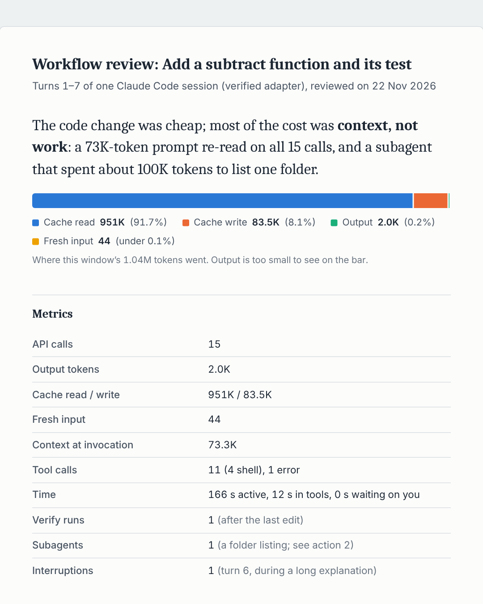

# workflow-reviewer

An agent skill that reviews **the coding-agent task you just finished**, in the same session. It finds where tokens and time went without improving quality, which process slips happened, and which skills overlap or are missing.

You get a short HTML report. The agent's reply in chat is the bottom line, the top action and the report's file path. A deterministic script counts everything; the agent only judges.

[](https://justin-nicky.github.io/workflow-reviewer-skill/examples/sample-report.html)

See a rendered report: [the sample report](https://justin-nicky.github.io/workflow-reviewer-skill/examples/sample-report.html) (synthetic data). The source is [examples/sample-report.html](examples/sample-report.html).

## Install

```bash
npx skills add justin-nicky/workflow-reviewer-skill -g
```

The [Skills CLI](https://www.npmjs.com/package/skills) puts one copy in `~/.agents/skills/workflow-reviewer` (read by Codex and Cursor) and links it into `~/.claude/skills/` for Claude Code. Add `-a <agent>` to pick the tools, or `--copy` to copy instead of link.

Or by hand: clone the repo and copy (or symlink) `skills/workflow-reviewer/` into your host's skill folder:

```bash
git clone https://github.com/justin-nicky/workflow-reviewer-skill
cp -r workflow-reviewer-skill/skills/workflow-reviewer ~/.claude/skills/
```

Requires **Python 3.9 or newer**; the `python3` built into macOS works. On Python 3.8 or older the script exits with code 5 and says so, and the skill retries with a newer `python3.x` if one is installed (for example after `brew install python@3.12`, or from python.org).

For hosts the CLI does not cover, use the host's own folder:

| Host | Skill folder | How to invoke it |
|---|---|---|
| Claude Code | `~/.claude/skills/` or `.claude/skills/` | `/workflow-reviewer` |
| Codex | `~/.agents/skills/` or `.agents/skills/` | `$workflow-reviewer` |
| Cursor | `.cursor/skills/` or `.agents/skills/` | `/workflow-reviewer` |
| Devin (desktop app and CLI) | `.cognition/skills/` or `~/.claude/skills/` | `/workflow-reviewer` |
| Cline | `.clinerules/skills/` | ask Cline to use the `workflow-reviewer` skill |
| Kiro | `.kiro/skills/` | ask for it by name; degraded mode (see below) |

It is **explicit-only**: Claude Code and Cursor read `disable-model-invocation: true` from `SKILL.md`, Codex reads `agents/openai.yaml` (`allow_implicit_invocation: false`). Kiro does not document an explicit-only setting, so it may occasionally trigger on its own. In Devin, `disable-model-invocation: true` hides the skill from the model, so you can type it but the model is never offered it.

Run it right after the task, in the same session.

## What you get

- A report file `<tempdir>/workflow-reviewer/review-<time>.html` (mode 0600), opened in your browser where there is a display. It is self-contained: inline CSS, no JavaScript, no network.
- On a host with no browser (cloud Devin, SSH, CI) the agent pastes the same report as markdown (80 lines at most).
- Contents: the bottom line, a metrics table with the token breakdown, up to five ranked actions (cause, cost, evidence; the change, why it is safe, what to watch), a skills audit (keep, improve, merge, overlap, gap) and, only when a gap was found, an offer to look for skills that cover it.

## Privacy

- Offline and read-only. The script reads local transcripts and writes only the report (and, on your explicit command, a user adapter or a synthetic replica). It imports no network module.
- Redaction is on by default: keys, tokens, emails and home paths are masked in everything printed, including the report. `--no-redact` turns it off for your own debugging.
- The agent never reads a raw transcript wholesale; it sees a summary and small, redacted event windows.
- `--probe` prints the structure of a file, folder or database (field names, types, counts, short type names) and never a value.

## Supported hosts and labels

| Host | Verified against | Notes |
|---|---|---|
| Claude Code | 2.1.295 to 2.1.309, 2.1.321 | full |
| Codex | 0.137.0-alpha.4 to 0.142.2; 0.162.0-alpha.17.2 (Codex Desktop); 0.171.0-alpha.13 (Codex Desktop) | full |
| Devin (desktop 3000.12.43, CLI) | database schema 20 | full; read from Devin's local SQLite database (read-only). Cloud Devin has no local database: degraded mode |
| Cline 4.1.26 | VS Code extension and CLI data under `~/.cline/data` | full for turns, tools, tokens, time and subagents; skills offered and instruction files are not recorded |
| Cursor | transcripts carry no version | no tokens, tool results or ids; interruptions, turn errors and a coarse wall time |
| Kiro | none | degraded mode: the working tree and repo records only |

Every report says whether the adapter behind it is **verified** (built in, with tested versions) or **unproven** (made by a user or in the session). A `coverage.health` table says whether each number can be trusted: `ok` (a second independent count agrees), `one_way` (only one way to count it), `warn`, `broken` or `not_measurable`. Only a broken core metric stops the review (exit 2).

## A host that is not supported, or a format that changed

The agent offers degraded mode, or builds an adapter in about five minutes: probe the data, draft a mapping, save it as a user adapter, check the health table, and produce the report. If the host's version is newer than the tested one, it can also give you the exact commands to propose the adapter upstream; it never runs them. The procedure is in [adapter-flow.md](skills/workflow-reviewer/references/adapter-flow.md). To add a host as a built-in, follow [adding-a-host.md](skills/workflow-reviewer/references/adding-a-host.md).

## Reference

How turns, windows, time and context are computed, the exit codes and the mapping keys: [hosts.md](skills/workflow-reviewer/references/hosts.md). The checklist, the skills audit and the findings format are in the same folder.

## Development

```bash
python -m pip install pytest
python -m pytest -q
```

Tests run the script black-box on synthetic fixtures only. Real transcripts are never committed. CI runs pytest on Linux, macOS and Windows with Python 3.9 to 3.13. The original design documents are kept in `docs/history/` for reference only.

## License

MIT
